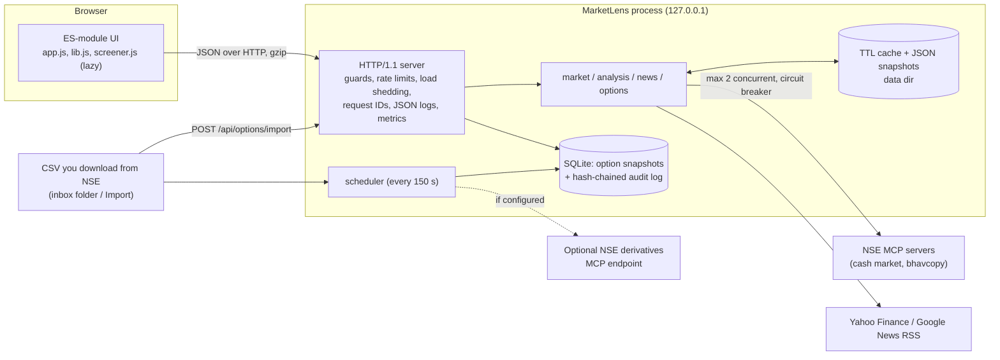
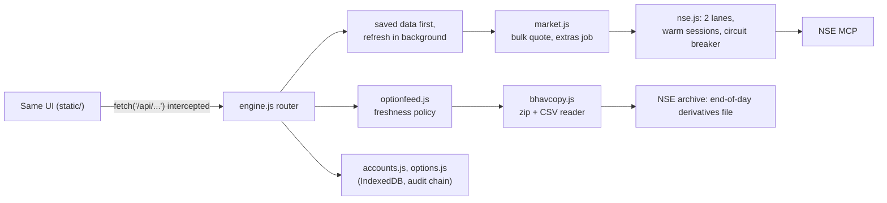

# Architecture

## Request path (a stock page)
`#/quote/TCS` → `api('/api/stock/TCS')` (10 s timeout, 2 retries with backoff and jitter, GET only) → server guard
(Host/Origin) → rate-limit class `expensive` → `stock_payload` → 5-minute TTL cache → (miss) NSE quote + history +
52-week range + corporate actions, in parallel but capped at 2 concurrent upstream calls → snapshot written to disk →
technical and income analysis computed from the history → gzip JSON. If NSE is unreachable the last disk snapshot is
served with `stale: true`, and the UI says so.

## Data freshness is separate from latency
A fast API response does not mean fresh data. Each payload carries its own `fetchedAt` / `asOf`; the status line shows
**Live**, **Delayed** (> 10 min old), **Stale** (server fell back to a saved snapshot), **Disconnected** (the browser
cannot reach the local server) and **Updating…** independently.

## Decisions and trade-offs

| Decision | Why | Trade-off |
|---|---|---|
| Polling every 60 s, not WebSockets/SSE | NSE data arrives per minute at best and upstream is pull-only; a push channel would add reconnect, replay and backpressure code with nothing to push. | Up to 60 s staleness; revisit if a push source appears. |
| SQLite, one file | Open source, in the standard library, ACID, enough for a few thousand snapshots. | Single writer; fine for one user. |
| No framework or build step | Few moving parts; one `pip install`. Lazy `import()` gives route-level code splitting for the largest view. | Hand-written rendering; no component library. |
| In-process token buckets keyed by TCP peer | Single instance, no network hop per request. `X-Forwarded-For` is ignored (forgeable). | Not shared across processes; behind a reverse proxy, limit at the proxy. |
| Limiter and audit failures degrade differently | A limiter bug fails **open** (availability). An import's audit row is in the same transaction, so it fails **closed** (no unaudited change). Non-critical audit events log a stderr alert and carry on. | A broken audit disk blocks imports until fixed. |
| Circuit breaker on NSE (15 min, persisted) | NSE's edge blocks clients that send bursts; retrying while blocked prolongs it. | A real outage and a block look the same to the app. |
| Stock list (names, industries, NSE codes) in the database, refreshed weekly, bundled copy as fallback (`securities.py`, phone: `securities.js`) | NSE's MCP servers do not supply sectors or names; the Nifty Total Market constituents file does (about 750 stocks, 22 industries). A copy in the app's own storage means a list change reaches users without an app release (it changed by one stock between two of my downloads), and the bundled file means first start and offline use still work. One validated download replaces the table in one transaction; a bad one changes nothing (Nifty Indices' site was seen answering with a web page instead of the file, and validation refused it). | A stock outside the list is "Other". The list is end-of-index-review fresh, not real time. |
| Peers = same industry, ranked by last session's turnover from ONE bulk quote per 50 stocks, then live quotes for the ten shown | the list has up to 123 stocks per industry; ranking needs no per-stock calls, and live prices are fetched only for what is on screen (11 calls, cached a minute) | Ranking is by yesterday's turnover, so a stock that is unusually active today may not appear; no P/E or market cap because NSE's servers do not provide them. |
| Rule constants in one table | one `RULES` table feeds both the scoring code and the on-page explanation | |
| No automatic download from NSE's website | The site is protected against automated access; imitating a browser is not acceptable. | The option chain needs a human download or an official endpoint. |

## Security model
Accounts: every API call except sign-up, sign-in, recovery, `/healthz`, `/readyz` and `/api/auth/status` needs a session, checked
on the server (see OPERATIONS.md, Accounts). Loopback only; Host and Origin must match (DNS-rebinding and cross-site protection); uploads need a custom header,
`text/csv`, ≤ 2 MB; strict CSP (`script-src 'self'`, no inline script), `nosniff`, `frame-ancestors 'none'`,
`Cross-Origin-Resource-Policy: same-origin`; all output escaped in the UI; RSS parsing rejects DOCTYPE/ENTITY
(entity-expansion attacks) and only `http(s)` links are kept; CSV export neutralises spreadsheet formulas; no secrets,
no cookies, no accounts, no third-party scripts.

## Phone app (mobile/)
The Android app runs the same UI on a JavaScript engine in the WebView instead of a Python server (docs/MOBILE.md). Design:

| Decision | Why |
|---|---|
| UI unchanged, requests intercepted at `fetch` | one UI for both apps; the engine is the only thing ported, and golden tests pin it to the Python output |
| Ports and adapters (`fetchFn`, `optionSource`, `storage`, `now` injected) | every piece is tested without a network or a clock |
| Stale-while-revalidate for every screen | perceived latency is the time to read local storage, not the time NSE takes |
| One bulk quote, one extras job at two lanes | requests are the cost: 19 for a cold home page instead of hundreds |
| Retry on the same MCP session | a misrouted call (404) costs 1 request, not a new 3-request session |
| Option chain from NSE's published end-of-day file | NSE's live option-chain API is protected against automated clients, so it is not used and no browser is imitated; the archive file is a legitimate download. The cost: end-of-day data, no implied volatility |
| Market clock as pure functions (`marketclock.js`) | "live or last update" is decided in one place, tested at the edges; holidays are inferred from quote dates because the app has no exchange calendar |
| Live prices as an overlay on the end-of-day base | the bulk call paints the page at once; per-stock live quotes replace values as they arrive; a refresh never replaces newer data with older |
| Freshness policy in one class (`OptionFeed`) | single-flight, 20-minute cooldown, always falls back to saved data; the UI never waits on a retry loop |
